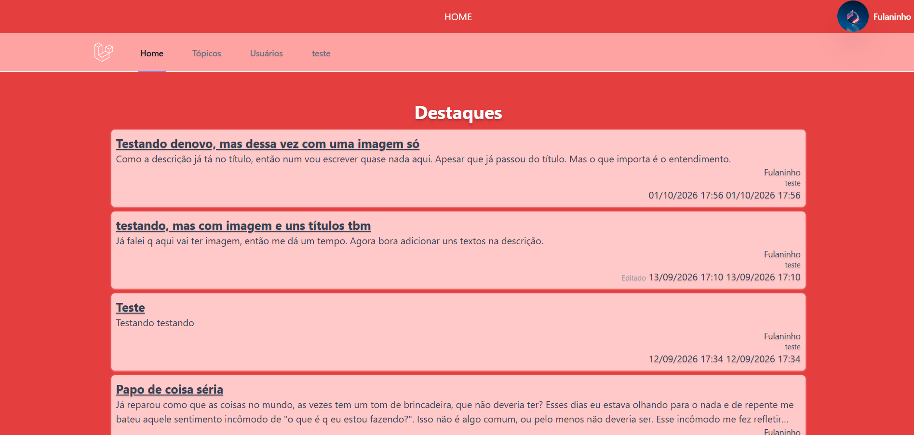
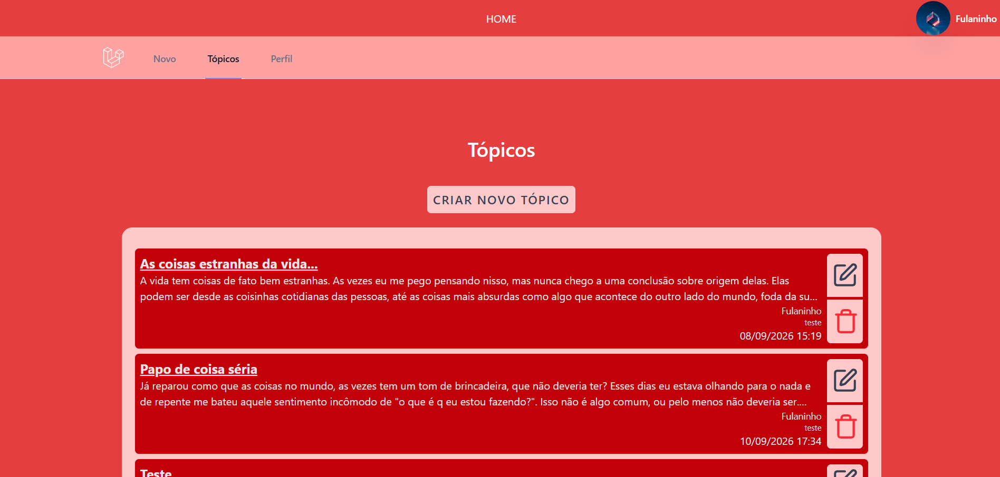
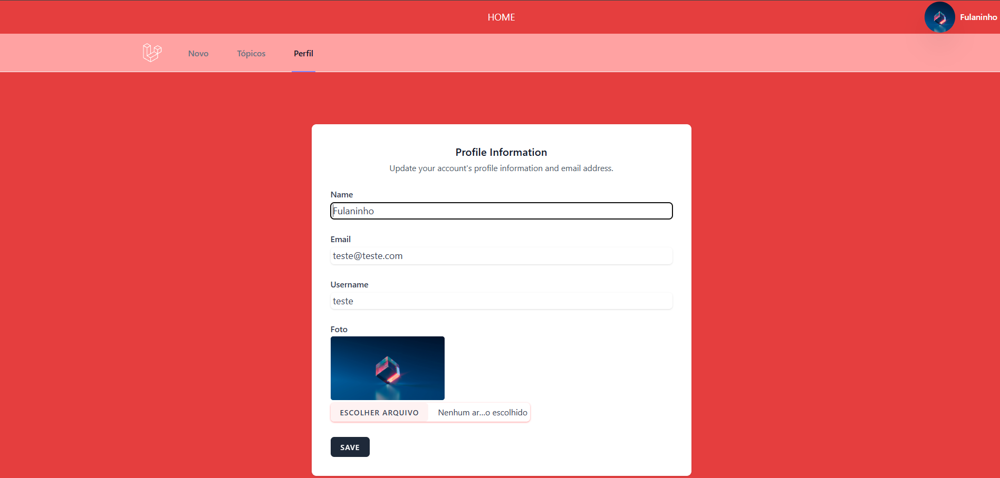
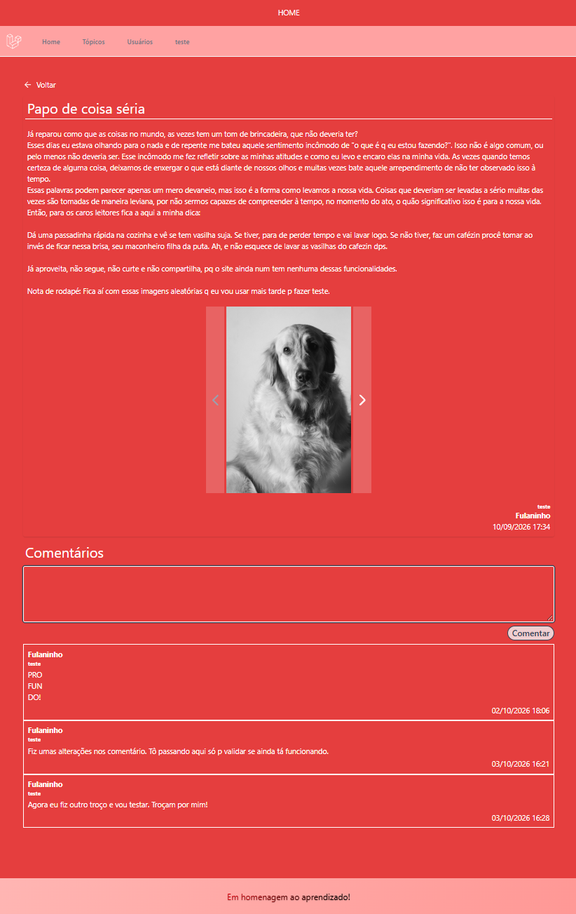

# 💬 Forum Simplificado - Laravel

Este é um projeto de um fórum de discussões simplificado, desenvolvido para praticar a construção de aplicações web completas utilizando o ecossistema Laravel. O objetivo é permitir que usuários interajam através da criação de tópicos e troquem conhecimentos por meio de comentários.

## 🚀 Funcionalidades

### ✅ Implementadas
- **Home:** Listagem dos tópicos de discussão mais recentes.
- **Autenticação:** Sistema completo de cadastro e login de usuários (via Laravel Breeze).
- **Dashboard de Atividades:** Área exclusiva do usuário para gerenciar seus próprios tópicos (Criar, Editar e Remover).
- **Página do Tópico:** Visualização detalhada de um tópico com a possibilidade de adicionar comentários.
- **Perfil do Usuário:** Espaço para visualização e edição das informações pessoais do usuário.

### 🛠️ Em Desenvolvimento
- [ ] Edição de comentários próprios.
- [ ] Página de busca e visualização de perfis de outros usuários.
- [ ] Página de pesquisa avançada para encontrar tópicos específicos.

## 🛠️ Tecnologias Utilizadas

- **Backend:** [Laravel](https://laravel.com/) (Framework PHP)
- **Frontend:** [Blade](https://laravel.com/docs/blade) & [Tailwind CSS](https://tailwindcss.com/)
- **Autenticação:** [Laravel Breeze](https://laravel.com/docs/starter-kits#laravel-breeze)
- **Ícones:** [Lucide Icons](https://lucide.dev/)
- **Banco de Dados:** MySQL / SQLite

## 📸 Screenshots

Aqui estão algumas capturas de tela da aplicação:

| Home | Dashboard | Perfil |
| :---: | :---: | :---: |
|  |  |  |

| Tópico e Comentários |
| :---: |
|  |

## ⚙️ Como executar o projeto localmente

1. Clone o repositório:
   ```bash
   git clone git@github.com:SEU_USUARIO/NOME_DO_REPO.git
   ```
2. Instale as dependências do PHP:
   ```bash
   composer install
   ```
3. Instale as dependências do Frontend:
   ```bash
   npm install && npm run dev
   ```
4. Configure o arquivo `.env` com suas credenciais de banco de dados.
5. Gere a chave da aplicação e rode as migrations:
   ```bash
   php artisan key:generate
   php artisan migrate
   ```
6. Inicie o servidor:
   ```bash
   php artisan serve
   ```
